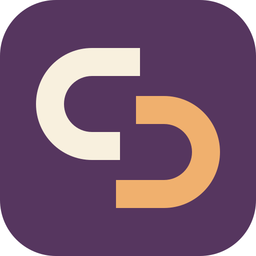

# grokpair

Give your agent a Grok Build collaborator for a second opinion or a separate
piece of work. Grok works in its own conversation while your agent continues,
then returns findings, code, documents or media for your agent to inspect and
use.

Use it to research a question with sources, review a change independently,
compare an alternative implementation in a native worktree, or produce a
document or media asset. Grok keeps its own model, tools, skills and
configuration. Your calling agent supplies the brief, checks the contribution
and decides what to adopt; credentials, integration and publication remain
its responsibility.

Native plugins are available for **Codex** and **Claude Code**. Other agents
can use the same eight tools through MCP or the command line.

## Requirements

- Node `>=24.21`, as `node` on the `PATH` the host gives the server.
- [Grok Build](https://docs.x.ai/build/overview), installed, authenticated
  and callable as `grok` on that `PATH`. Follow its native setup guide;
  grokpair does not install Grok or manage its login.
- Git and a source repository, only for native worktree isolation; Grok's
  utility owns its creation prerequisites.

Bring your own authenticated Grok Build account. Inference and connected
services use that account and its native billing; grokpair provides no account,
hosted backend or included usage. The committed `plugin/` payload is already
built and needs no dependency installation to run. Contributors need the
pinned pnpm and the lockfile; see [AGENTS](AGENTS.md#build-test-and-inspect).

## Install

Add the [Tiziano AI marketplace](https://github.com/Tiziano-AI/plugins), then
install **`grokpair@tiziano-ai`**. Adding the catalog does not install its
other plugins. Installing Grokpair does not start a collaborator or sign you
into Grok Build.

**Codex**

```bash
codex plugin marketplace add Tiziano-AI/plugins
codex plugin add grokpair@tiziano-ai
```

Use the CLI for your intended Codex installation; the desktop app's bundled
CLI can differ from `codex` on your `PATH`. Codex gets the MCP server
`grokpair` and the operating skill.

**Claude Code**

```bash
claude plugin marketplace add Tiziano-AI/plugins
claude plugin install grokpair@tiziano-ai --scope user
```

Claude Code gets the tools as `mcp__plugin_grokpair_grokpair__grok_*`, the
operating skill, the relay agent `grokpair:grok`, and the `grokpair` command
on its Bash tool's `PATH`.

Start a fresh caller after installation and check that the Grokpair skill and
tools are available. Installing files does not reload a server already bound
to an open session.

**Approvals are yours:** all eight tools follow the host's normal policy.
grokpair ships no auto-allow hook or approval override and does not change
your settings. Choose any standing approvals in your own host, within the
authority you want to delegate.

**Grok Build** loads the plugins installed for Claude Code, and grokpair must
not be offered to Grok itself. Where grokpair is installed for Claude Code,
disable it for Grok in `~/.grok/config.toml`:

```toml
[plugins]
disabled = ["grokpair"]
```

If `[plugins]` or `disabled` already exists, add `"grokpair"` to the existing
list; preserve its other entries.

Independently, a grokpair started beneath a collaborator serves no tools.

## First use

Ask your agent:

> Use grokpair for a read-only second opinion on this proposal while you
> continue your own analysis. Give Grok the relevant sources and ask for the
> strongest supported reason to change it. Read its complete answer and check
> the findings before adopting them. Grok must not edit files, contact anyone
> or publish.

The agent should follow the installed [operating
skill](plugin/skills/grokpair/SKILL.md). It can ask for corrections in the same
Grok conversation rather than starting over.

<details>
<summary>Follow the tool cycle directly</summary>

Grok does not see your conversation. Write a self-contained brief: purpose,
facts and sources, the result you need, and limits on files and effects. Point
`cwd` at the real directory the work is about; it need not be a Git repository.

Start the collaborator with `grok_spawn`:

```json
{
  "task": "Review proposal.md and its supporting files in this directory. Return the strongest supported reason to change the proposal, with file references and a concrete recommendation, to me, the calling agent. I am checking the assumptions separately. Read only; do not edit files, contact anyone or publish.",
  "cwd": "/absolute/path/to/research-directory",
  "key": "proposal-review-7f3a"
}
```

It returns `agent_id` and `operation_id` at once, not the answer. The `key`
makes an identical normalized retry return the same collaborator instead of
a second one, with `call_status: "existing"`, its `agent_id` and no
`operation_id`; wait on it by `agent_id` either way.
Recover a lost spawn response by repeating the same keyed request, not by
inventing a new key. A changed request conflicts with a held key; change
existing work with `grok_send`. Missing or unreadable original state retains
the key rather than allowing a duplicate.

Without `worktree`, Grok works in `cwd`. Add `"worktree": true` when the
contribution needs a separate native Git worktree; native copy rules include
uncommitted work but do not promise to copy every file. Add `"sandbox":
"<native profile>"` only for an intentional profile selection. Otherwise no
sandbox flag is passed and Grok resolves its configuration, which may be
`off`. File placement and sandbox selection are independent; the brief still
defines file and effect authority. Effective sandbox enforcement is not
observable through ACP. A denial is returned, not worked around. See
[Files and workspaces](plugin/skills/grokpair/references/files-and-workspaces.md)
before attaching files or integrating a worktree.

Do your own work, then collect the result with `grok_wait`:

```json
{ "targets": [{ "agent_id": "agent_…" }], "timeout_ms": 300000 }
```

By default it returns when Grok has settled or needs a decision, with its
text, outcome and any reported questions, files, issues or background tasks.
A timeout leaves Grok working; wait again with the returned `cursor`. While
`has_more` is true, continue with `grok_read`:

```json
{ "agent_id": "agent_…", "cursor": "gp1.…" }
```

Read a question completely before answering it, and drain the result pages
before accepting the contribution. Large structured records can arrive as
incomplete JSON `fragments`; the operating skill explains how to reconstruct
them. If a host shortens a response, reread from the preceding cursor with a
smaller `max_chars`. A finished turn can also name a `text_file` containing
its complete text; other records still need to be read through the tools.

Follow up with `grok_send` when it improves the result. Inspect the actual
files, changes and media before using them: a completed turn does not certify
their quality or prove background work has ended. Use `grok_close` when the
collaborator no longer helps; closing can cancel active work and deletes
nothing.

The same cycle from a shell, keeping `timeout_ms` below the shell tool's own
timeout and waiting again as needed:

```bash
node /absolute/path/to/grokpair/plugin/bin/grokpair spawn '{"task":"Review proposal.md read-only. Return the strongest supported reason to change it, with file references, to me, the calling agent. Do not edit files, contact anyone or publish.","cwd":"/absolute/path/to/research-directory","key":"proposal-review-cli-7f3a"}'
node /absolute/path/to/grokpair/plugin/bin/grokpair wait '{"targets":[{"agent_id":"agent_…"}],"timeout_ms":90000}'
node /absolute/path/to/grokpair/plugin/bin/grokpair read '{"agent_id":"agent_…","cursor":"gp1.…"}'
# Inspect the complete answer and its sources; request corrections with send if needed.
node /absolute/path/to/grokpair/plugin/bin/grokpair close '{"agent_id":"agent_…"}'
```

In Claude Code, the relay agent `grokpair:grok` can run this cycle in the
background and return Grok's answer verbatim. It leaves the collaborator open
for your inspection and corrections unless the brief explicitly requests a
one-shot contribution. You close it after acceptance. See the operating skill
for the relay's hand-back behavior and retained output paths.

</details>

## Other hosts and pinned releases

**Any other MCP host** can start
`node /absolute/path/to/grokpair/plugin/bin/grokpair mcp` from a checkout as
a stdio server; give its tool calls a timeout above 600 seconds, the longest
wait. **Any agent with a shell** can use the command shown above. Run
`version` first to identify that checkout; using it directly is not a native
plugin installation.

<details>
<summary>Install a release tag instead of the shared catalog</summary>

The product-local `grokpair` marketplace can select an annotated release
tag. These commands pin **2.3.1**; the repository's
[Git tags](https://github.com/Tiziano-AI/grokpair/tags) identify published
releases. Choose this route or the shared catalog, not both in the same host.

```bash
# Codex
codex plugin marketplace add Tiziano-AI/grokpair --ref v2.3.1
codex plugin add grokpair@grokpair

# Claude Code
claude plugin marketplace add Tiziano-AI/grokpair@v2.3.1
claude plugin install grokpair@grokpair --scope user
```

</details>

## Update, disable or uninstall

Refresh the `tiziano-ai` catalog and update only Grokpair through the owning
host's native controls; the [marketplace guide](https://github.com/Tiziano-AI/plugins#update-or-remove)
shows the host commands. Before replacing an active version, account for its
collaborators, pending decisions, workers and native processes. Installation
does not end detached work or fence old writers. [RELEASE](RELEASE.md) owns
the cutover procedure.

All hosts share one store at `~/.local/state/grokpair`. `GROKPAIR_HOME`
overrides it; set it for every host or for none, or each host will see its own
collaborators. If an old session's launcher was removed during an update,
spawn returns `worker_unavailable` without admitting work. Obtain a fresh
binding through the owning host rather than editing its cache.

Use your host's native plugin controls. Removing a plugin stops future
discovery; it does not close detached collaborators, erase results, delete
native sessions or worktrees, revoke Grok credentials, or unload servers that
an existing session already started. Inspect and explicitly close work you
intend to end before removing its callable entrypoint. Close can cancel active
work and deletes no retained data. Native state and connected-service
retention remain with their owners; [PRIVACY](PRIVACY.md) describes the store.

Remove only the plugin:

```bash
codex plugin remove grokpair@tiziano-ai
# OR
claude plugin uninstall grokpair@tiziano-ai --scope user
```

Keep the shared marketplace if you use its other plugins. If you installed
the product-local route instead, remove `grokpair@grokpair` through that
host. Verify in a fresh caller that grokpair is no longer offered. Existing
sessions may retain a loaded server; removing files does not establish that
it has exited.

## Read further

Source version **2.3.2** refines documentation, caller guidance and plugin
presentation without changing runtime behavior from 2.3.1. The repository's
[Git tags](https://github.com/Tiziano-AI/grokpair/tags) identify published
source; the shared [catalog](https://github.com/Tiziano-AI/plugins) selects
its offered revision. Installed and useful fresh-caller acceptance is
recorded for **2.3.1** and is not inherited by 2.3.2.

Public schema **3**, runtime-v2, SQLite format 1 and `gp1.` cursors are
unchanged. The store and cursor contracts are separate from the package
version. [RELEASE](RELEASE.md) distinguishes source preparation, publication
and installed acceptance.

- [Operating skill](plugin/skills/grokpair/SKILL.md): the collaboration cycle
  as callers use it.
- [VISION](VISION.md): what the product is for and what makes a contribution
  useful.
- [ARCH](ARCH.md): design, invariants, packaging and source owners.
- [Capabilities](docs/capabilities.md): the complete public contract.
- [SECURITY](SECURITY.md), [PRIVACY](PRIVACY.md), [TERMS](TERMS.md):
  authority, retained data and terms.
- [PLAN](PLAN.md), [RELEASE](RELEASE.md), [CHANGELOG](CHANGELOG.md):
  implementation and proof, delivery, changes.
- [AGENTS](AGENTS.md): working on grokpair itself.
